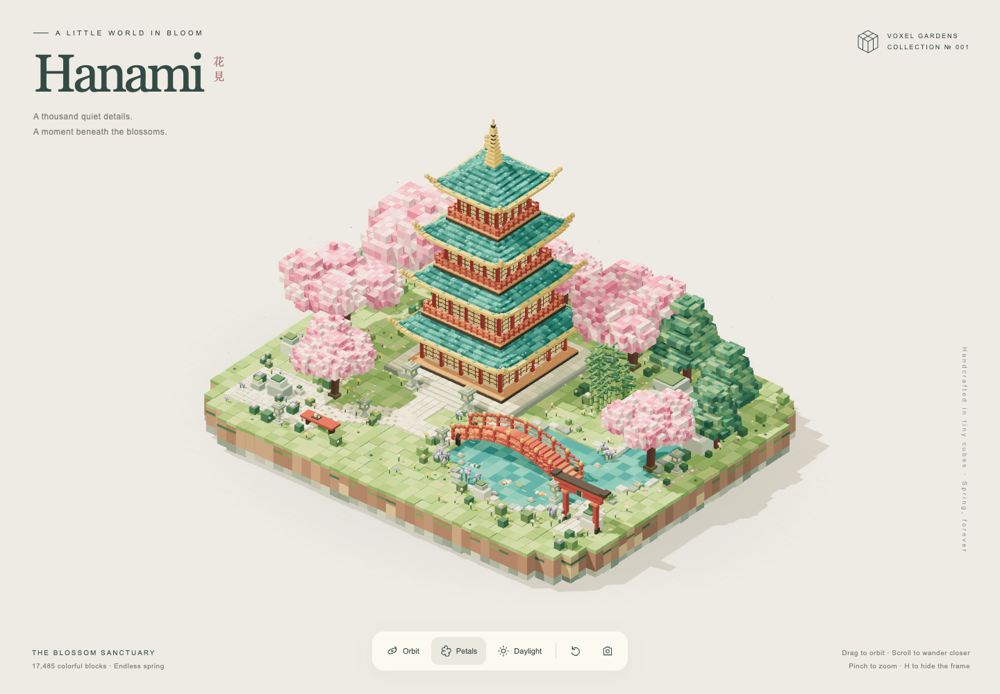

# Hanami — 花見

An interactive voxel garden built from 17,485 colorful blocks, featuring a four-tier pagoda, cherry blossoms, bamboo, an arched bridge, koi, stone lanterns, and a waterfall.

## Open the garden

Open `index.html` directly in a modern browser. Everything, including Three.js, is embedded in this single file. No installation, build step, or network connection is required.

## Controls

- Drag to orbit; scroll or pinch to zoom.
- Arrow keys rotate; `+` / `-` zoom.
- **O** toggles automatic orbit.
- **P** toggles petals and water animation.
- **L** cycles daylight, golden hour, and moonlight.
- **R** resets the camera.
- **H** hides the interface.
- The camera button saves the current scene as a PNG.

Respects reduced-motion preferences. Requires browser WebGL support.

## Deployment

GitHub Pages serves the repository's root on the `main` branch. Updating `index.html` and pushing to `main` publishes the new version.

## Credits

Procedural geometry and styling are contained in `index.html`. The embedded Three.js r160 library is MIT-licensed; its license notice is included in the file.
